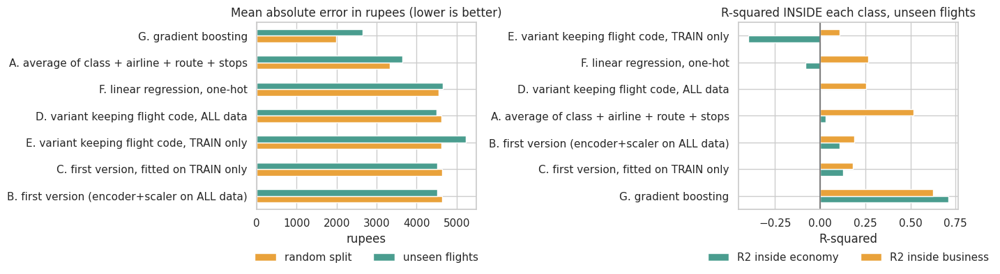
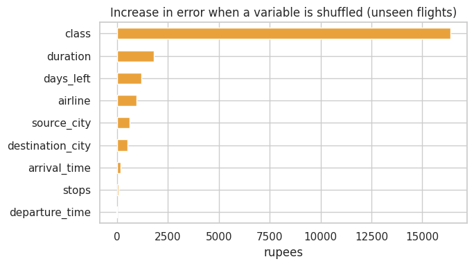
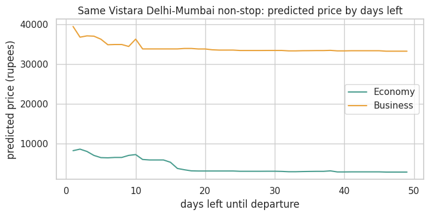

# Flight ticket prices: how much do models really add?

Predicting the price of a flight ticket with **300,153 bookings** scraped from EaseMyTrip between 11 February and 31 March 2022
(flights among India's six largest cities), and finding out how much a model adds over very simple rules, and how well it works for flights
it has **never seen**.

## Main findings

- **A single variable explains most of the price.** Business costs about nine times more than Economy, so the class alone gives an
  R-squared of **0.88**. R-squared is high for almost any model here, so the notebook looks at the **error in rupees** and the
  R-squared **inside each class**.
- **Linear models add little.** They are *worse than a lookup table* of class + airline + route + stops.
- **A non-linear model does add value:** gradient boosting cuts the error by about 40 % for known flights and 27 % for unseen ones.
- **A random split flatters the model:** for flights it has never seen, the error is 34 % higher (56 % higher in Business).

| Model | Error, known flights (rupees) | Error, unseen flights (rupees) | R² inside Economy (unseen) | R² inside Business (unseen) |
|---|---:|---:|---:|---:|
| Average price of class + airline + route + stops | 3,330 | 3,645 | 0.03 | 0.52 |
| First version (linear, encoders fitted on all data) | 4,633 | 4,525 | 0.11 | 0.19 |
| Linear regression, one-hot | 4,553 | 4,651 | -0.08 | 0.27 |
| **Gradient boosting** | **1,981** | **2,660** | **0.71** | **0.63** |

The average price of the class alone has an error of 4,876 rupees. "Known flights" is a random 80/20 split; "unseen flights" holds out
whole flight codes (none of them is in the training data).



## What drives the price

The class by far (shuffling it adds 16,382 rupees of error), then the duration (1,809), the days left (1,199) and the airline (957).
The cities matter a little (about 500 to 600); the departure time and the number of stops hardly at all.



For the same Economy ticket the model predicts about **8,300 rupees one day before departure and about 2,900 rupees 49 days before**,
flat after roughly three weeks.



## Encoding categories with all the data

The first version replaced each category by its average price **using all the data, before splitting**. It hardly mattered there
(error 4,633 against 4,632 rupees), because the flight code was dropped and the other categories have few values. The same shortcut
**is dangerous for a high-cardinality identifier**: had the flight code (1,561 values) been kept, an encoder fitted on all the data would
have reported an error of 4,496 rupees against 5,232 for unseen flights.

## What I changed from my first version

- The encoders and the scaler were fitted on **all** the data before the train/test split. Everything is now fitted on the training rows only.
- It used a **single linear model** judged only by R-squared. Now there are simple lookup-table baselines, a non-linear model and the error in rupees.
- The split was **random only**. Flight codes repeat 55 times on average, so a second split holds out whole flights.
- **No results were saved.** The notebook now runs end to end with its outputs.

## Limitations

- One scrape of 50 days from one website, with no trip dates: the model cannot be tested over time or on seasonality and holidays.
- These are asking prices on the day of the scrape, not what travellers paid.
- Business class is offered only by Air India and Vistara.
- Splitting by flight code tests new flight codes, but the routes, airlines and schedules still repeat; a new route or another market would be harder.
- The boosting model was not tuned.

## Run it

```bash
pip install -r requirements.txt
# put Clean_Dataset.csv in data/  (see data/README.md)
jupyter notebook flight_price_prediction.ipynb
```
